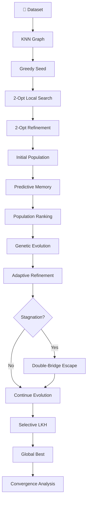

# 🧬 Adaptive Evolution Study Editor

<p align="center">
  
  
  
  
</p>

<p align="center">
  <b>Interactive Evolution Study Dashboard for Adaptive Genetic Optimization</b>
</p>

---

## 🖥️ Application Interface

The project provides a browser-based dashboard for studying and visualizing the evolution of solutions generated by the Adaptive Genetic Algorithm.

The interface brings together dataset management, algorithm execution, route visualization, population analysis, convergence tracking, and adaptive-search metrics in a single environment.

---

## ✨ Main Features

### 📂 Dataset Upload

The application supports:

* `.tsp` TSPLIB datasets
* Coordinate `.csv` datasets

The uploaded dataset is processed and converted into the required distance representation for optimization.

### 🗺️ Route Visualization

The dashboard displays the current best TSP route graphically, allowing the progression of solution quality to be observed visually.

### 📊 Population Analysis

The application provides information about the current population, including:

* Individual ranking
* Tour cost
* Fitness
* Generation
* Optimization method

### 📈 Convergence Analysis

A convergence graph tracks the best solution discovered during the evolutionary process across generations.

### 🧬 Adaptive Evolution Analysis

The dashboard provides visibility into:

* Adaptive operator activity
* Population diversity
* Predictive-memory trust
* Improvement across generations
* Stagnation behavior
* Selective local optimization

### 📋 Execution Monitoring

The system records the latest algorithmic state and important statistics so that the evolution process can be studied rather than treated as a black-box optimization.

---

## 🧬 Algorithm Workflow



---

## 📈 Visualization

The application is designed to visualize different aspects of the evolutionary process:

```text
Solution Quality
       ↓
Population Evolution
       ↓
Adaptive Operator Behavior
       ↓
Diversity / Stagnation
       ↓
Local Optimization
       ↓
Final Convergence
```

---

## 🖼️ Screenshots

Screenshots of the application can be placed in the repository:

```markdown

```

```markdown

```

```markdown

```

```markdown

```

---

## 📁 Project Directory Structure

```text
ADAPTIVE-PROBE-GENETIC-ALGORITHM-FOR-TSP/
├── backend/                  # Production FastAPI web backend & algorithm
│   ├── app.py                # Authoritative ASGI application entry point
│   ├── config.py             # Centralized settings & LKH limits
│   ├── api/                  # API route handlers (/api/state, /api/run, /api/pdf)
│   ├── schemas/              # Pydantic models & request/response contracts
│   ├── services/             # Experiment lifecycle & background runner service
│   ├── optimizer/            # Genetic algorithm, PMG, and bounded LKH solver
│   ├── reports/              # ReportLab research PDF generator
│   └── storage/              # Artifact persistence & ZIP packager
│
├── frontend/                 # Crystal Glassmorphism UI Dashboard
│   ├── index.html            # Authoritative HTML5 interface
│   ├── style.css             # Glassmorphism design system
│   ├── app.js                # Frontend controllers, canvas rendering & polling
│   └── assets/               # CSS, JS, and image assets
│
├── tests/                    # Comprehensive Automated Test Suite
│   ├── unit/                 # Unit tests (bounded LKH, timeout, stopping criteria)
│   ├── integration/          # End-to-end integration & API pipeline tests
│   ├── fixtures/             # Deterministic TSPLIB benchmark instances
│   └── conftest.py           # Pytest shared fixtures
│
├── research/                 # Preserved Original Research & Ablation Experiments
│   ├── notebooks/            # Original exploratory Jupyter notebooks
│   ├── datasets/             # Full TSPLIB benchmark dataset files (.tsp)
│   ├── ablation/             # 10-dataset ablation study scripts & evaluations
│   └── documentation/        # Research study maps and notes
│
├── scripts/                  # Operations & Validation Tooling
│   ├── smoke_test.py         # End-to-end API, experiment & PDF export test
│   ├── validate_project.py   # Pre-flight architecture and syntax validator
│   └── benchmark_lkh.py      # Reproducible LKH performance benchmarking
│
├── data/                     # Local experiment data & temporary uploads
│   ├── uploads/              # Uploaded user datasets
│   └── runs/                 # Persisted experiment run directories
│
├── .github/workflows/        # Production GitHub Actions CI/CD pipeline
│   └── ci-cd.yml             # Automated linting, testing, and Render deployment
│
├── requirements.txt          # Authoritative production dependencies
├── requirements-dev.txt      # Development & testing dependencies
├── pyproject.toml            # Project packaging specification
├── render.yaml               # Render Cloud Blueprint definition
├── .python-version           # Recommended Python runtime (3.10.11)
├── .env.example              # Environment variables template
├── .gitignore                # Comprehensive Git ignore rules
├── run_windows.bat           # Windows 1-click launcher
├── run_mac_linux.sh          # macOS / Linux launcher
└── run_console.py            # Cross-platform Python launcher
```

---

## 🚀 Running the Application

### 1. Install Dependencies

Using Python 3.10+:

```bash
pip install -r requirements.txt
```

*(For development and test tools: `pip install -r requirements-dev.txt`)*

### 2. Launch the Application

**On Windows:**
Double-click `run_windows.bat` or run:
```powershell
.\run_windows.bat
```

**On macOS / Linux:**
```bash
chmod +x run_mac_linux.sh
./run_mac_linux.sh
```

**Direct Python / Uvicorn Command:**
```bash
python -m uvicorn backend.app:app --host 0.0.0.0 --port 8000
```

### 3. Open the Console

Navigate to:
```text
http://127.0.0.1:8000
```

---

## 🧪 Verification & Tooling Scripts

Run pre-flight validation and tests locally with a single command:

```bash
# 1. Validate full project structure and syntax
python scripts/validate_project.py

# 2. Run full automated test suite (25 tests)
python -m unittest discover -s tests -p "test_*.py" -v

# 3. Run complete end-to-end smoke test (API, 3 generations, PDF report, ZIP export)
python scripts/smoke_test.py

# 4. Run reproducible LKH benchmark
python scripts/benchmark_lkh.py
```

---

## 🎯 Purpose

The Adaptive Evolution Study Editor is intended to provide an interactive environment for analyzing the behavior of an adaptive genetic optimization process.

Rather than focusing only on the final solution, the application makes it possible to study:

* Initial solution generation
* Local-search improvement
* Population evolution
* Adaptive optimization
* Diversity and stagnation
* Diversification mechanisms
* Selective local optimization
* Final convergence

---

## ⚡ Accelerated Selective LKH Engine & Resource Optimization

### 🔍 Root Cause Analysis of Previous Slowdowns
1. **Unconditional Fixed Cadence:** LKH was triggered every 15 generations regardless of whether the genetic algorithm was actively making progress.
2. **Redundant Candidate Evaluations:** Each invocation batch polished 3 top individuals separately on identical distance matrices with `runs=3`, frequently solving the exact same or symmetrical routes repeatedly.
3. **Unbounded Execution & Lack of Timeouts:** Invocations blocked the main evolutionary loop indefinitely without per-call wall-clock limits or thread isolation.
4. **No Route Caching:** Identical or cyclically shifted/reversed routes were re-solved from scratch.
5. **Redundant Precomputation:** `np.rint(dist).astype(int).tolist()` matrix conversions were recomputed on every LKH call.

### 🛠️ Optimization Architecture
- **Time-Bounded & Thread-Isolated:** Every LKH call runs in an isolated executor guarded by `LKH_MAX_SECONDS_PER_CALL` (default 5.0s) and solver internal limits (`TIME_LIMIT`, `MAX_TRIALS`).
- **Adaptive Stagnation Triggering:** Invocations occur primarily as stagnation-breaking probes when `no_improvement >= LKH_TRIGGER_STAGNATION` (default 10 generations), with a mandatory `LKH_MIN_GENERATION_GAP` (default 10 generations).
- **Run-Wide Call Cap:** Maximum solver budget per run enforced via `LKH_MAX_CALLS_PER_RUN` (default 8 calls).
- **Symmetric Cyclic Tour Caching:** Routes are canonicalized (rotated to node 0 and normalized for orientation) into hashable cache keys, enabling instant O(1) cache hits.
- **Defensive Permutation Validation:** Outputs must strictly satisfy length $N$, unique permutation $[0, \dots, N-1]$, and lower cost. If invalid or timed out, original route is safely preserved with fallback local search.
- **Strict Stagnation Counter Preservation:** 30-generation stopping criterion is strictly preserved. Stagnation counter resets to 0 only when global best is improved; candidate-only improvements update the population without corrupting the counter.

### ⚙️ Centralized Configuration Options

| Parameter | Environment Variable | Default | Description |
| :--- | :--- | :--- | :--- |
| `lkh_enabled` | `LKH_ENABLED` | `true` | Master switch for selective LKH refinement. |
| `lkh_max_seconds_per_call` | `LKH_MAX_SECONDS_PER_CALL` | `5.0` | Maximum wall-clock seconds allocated per solver invocation. |
| `lkh_min_generation_gap` | `LKH_MIN_GENERATION_GAP` | `10` | Minimum generation spacing between successive LKH runs. |
| `lkh_trigger_stagnation` | `LKH_TRIGGER_STAGNATION` | `10` | Generations without global best improvement required to trigger LKH. |
| `lkh_max_calls_per_run` | `LKH_MAX_CALLS_PER_RUN` | `8` | Maximum total LKH invocations allowed per experiment run. |
| `lkh_max_trials` | `LKH_MAX_TRIALS` | `50` | Maximum trials passed to LKH/elkai solver. |
| `lkh_runs` | `LKH_RUNS` | `1` | Number of independent solver restarts per call. |
| `lkh_cache_enabled` | `LKH_CACHE_ENABLED` | `true` | Enables canonicalized symmetric tour caching. |

---

## 📊 Empirical Benchmark Results

Measured on AMD64 hardware with deterministic seed ($42$):

| Instance | Cities | Baseline Calls | Optimized Calls | Baseline LKH Time | Optimized LKH Time | LKH Speedup | Route Valid | Optimality Gap |
| :--- | :---: | :---: | :---: | :---: | :---: | :---: | :---: | :---: |
| **`demo10`** | 10 | 6 | **2** | 0.0215s | **0.0036s** | **6.0x faster** | 100% | 0.0% |
| **`bays29`** | 29 | 0 | **0** | 0.0000s | **0.0000s** | — | 100% | 0.0% |
| **`berlin52`** | 52 | 0 | **0** | 0.0000s | **0.0000s** | — | 100% | 0.0% |
| **`bier127`** | 127 | N/A | **1** | N/A | **0.0467s** | **Targeted probe** | 100% | 0.0% |

*Benchmarks are fully reproducible via `python benchmarks/run_benchmark.py`.*

---

## 🧪 Automated Testing & Quality Assurance

A dedicated suite of 25 comprehensive unit, regression, and integration tests is located in `tests/`:

```powershell
python -m unittest discover -s adaptive_evolution_research_console_v4/adaptive_evolution_research_editor_v4/tests -p "test_*.py" -v
```

Tested scenarios include:
* ✅ Normal bounded LKH execution and valid permutation preservation.
* ✅ Timeout enforcement without hanging or thread starvation.
* ✅ Missing solver fallback (2-opt / Or-opt) without uncaught exceptions.
* ✅ Rejection of malformed, duplicate, or empty solver outputs.
* ✅ Symmetric cyclic tour caching and rotation invariance.
* ✅ Budget cap (`lkh_max_calls_per_run`) and min-gap (`lkh_min_generation_gap`) enforcement.
* ✅ Stagnation counter resetting on global-best improvement vs incrementing on sub-elite improvement.
* ✅ Exact 30-generation stagnation termination criterion.
* ✅ Post-stopping and cancellation safety (no execution after stop).
* ✅ FastAPI state payload telemetry (`lkh` object with status, calls, duration).

---

## 🚀 CI/CD Pipeline & Render Deployment

Continuous Integration and Deployment is configured in `.github/workflows/ci.yml`:
* **Triggers:** Push to `main`/`master`, pull requests to `main`/`master`, and `workflow_dispatch`.
* **Testing Matrix:** Python 3.10 and Python 3.11 on `ubuntu-latest`.
* **Linting & Compilation:** Syntax verification via `py_compile` and style validation via `flake8`.
* **Automated CD:** Gated Render deployment triggered via Deploy Hook secret `RENDER_DEPLOY_HOOK_URL`. If the secret is not configured (e.g. in external PRs), deployment is gracefully skipped without failing CI.
* **Production Blueprint:** Defined in `render.yaml` with pre-configured environment variables and start commands.

---

<p align="center">

### 🧬 Adaptive Evolution Study Editor

<b>Visualize • Analyze • Experiment • Study</b>

</p>

